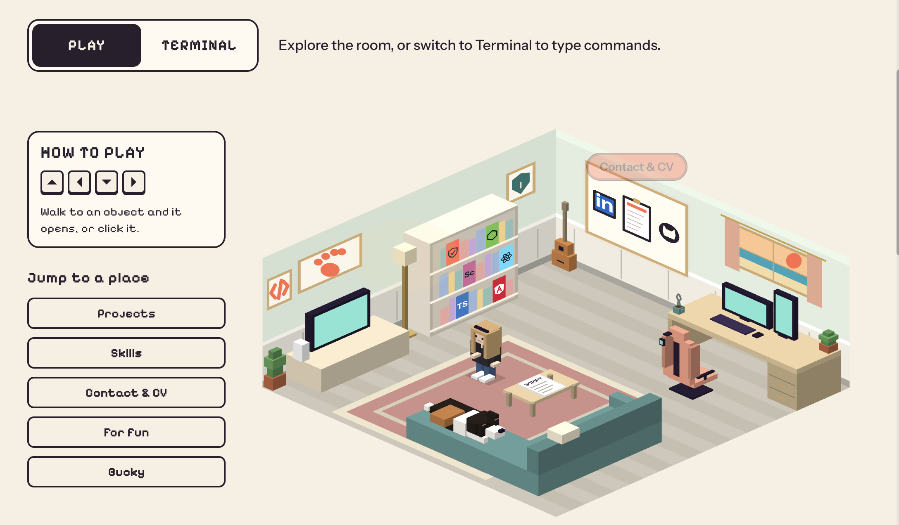
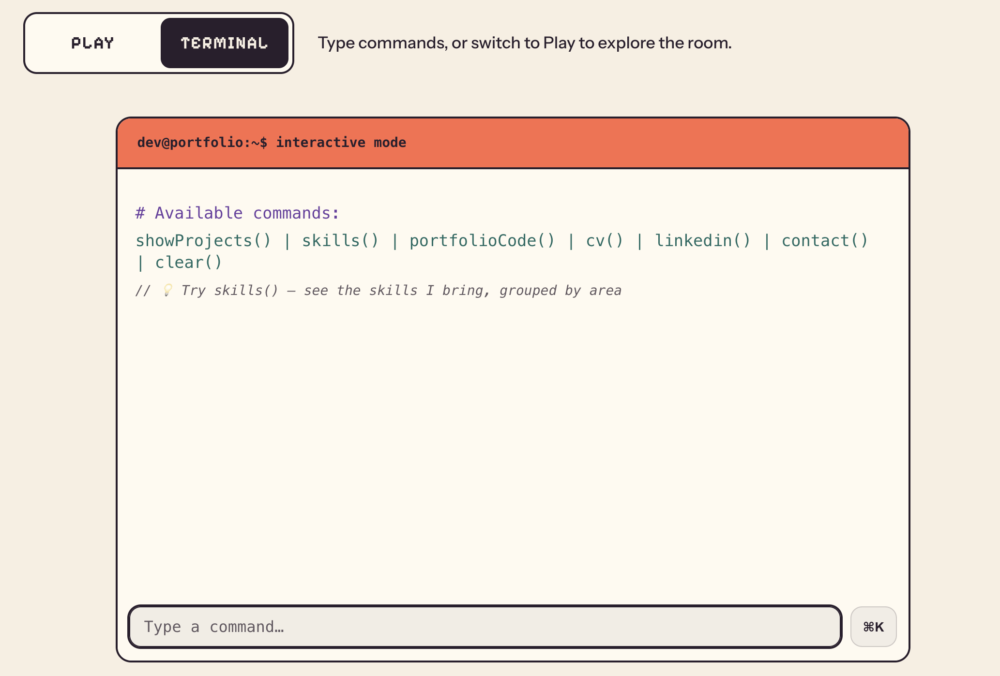

# Chen Leiv — Portfolio

My personal portfolio as a frontend engineer: an isometric room you can walk around, plus a terminal you can type commands into.

**Live:** https://chenleiv.vercel.app
**Source:** https://github.com/chenleiv/my-portfolio



## What's inside

- **Play and Terminal modes.** One page with a switch. Play lives at `/` and Terminal at `/console`. Switching changes the URL without a reload, and Back / Forward switch modes too.
- **Interactive isometric room.** An SVG room drawn in code. Walk Chen around with the arrow keys (W A S D also work). Walk up to an object to open it, or click it. A row of Places buttons opens each object directly. The objects are Projects, Skills, Contact & CV, For fun and Bucky.
- **Terminal.** Commands for projects, skills, contact, CV, LinkedIn, the source code and clear, with autocomplete and command history. A command palette opens with ⌘K / Ctrl+K. On small screens a command sheet replaces typing.
- **Projects.** Cards for InsightDesk (AI document workspace) and SignalForge (security operations dashboard), with links to the live demos and the code.
- **Light and dark themes.** Light is the default. Your choice is saved and applied before first paint. Animations respect `prefers-reduced-motion`.



## Tech stack

Next.js 16 (App Router), React 19, TypeScript (strict), SCSS, ESLint 9. Tests run on Node's built-in test runner.

## Run locally

Developed on Node.js 26.

```bash
npm install
npm run dev      # development server at http://localhost:3000
npm run build    # production build
npm start        # serve the production build
npm test         # unit tests (node --test)
npm run lint     # ESLint
```

## Project structure

```
src/
  app/            Next.js routes: / (Play) and /console (Terminal), layout, globals
  components/
    room/         isometric room: projection, walking, depth order, scene drawings
    mode-switch/  Play | Terminal switch and the area under it
    about-console/  terminal: commands, palette, mobile command sheet
    projects/  skills/  hero/  footer/  theme-toggle/
  content/        site text and contact links
  context/        theme provider
  hooks/          console and layout hooks
  fonts/          self-hosted fonts (OFL)
```

## Decisions

- **The mode follows the URL.** `/console` can be linked and bookmarked, and the browser history buttons switch modes (`src/components/mode-switch/ModeArea.tsx`).
- **The terminal loads on demand.** It is a client-only chunk, loaded only when Terminal is shown or about to be, so it stays out of the first load.
- **Room logic is plain TypeScript with no runtime imports.** Movement, collision, depth order and layout can be tested with `node --test` without a bundler (`src/components/room/*.test.ts`).
- **Room popups use the native `<dialog>`** with `showModal()`, which makes the rest of the page inert and closes on Esc.
- **Fonts are self-hosted** with `next/font/local`, so no request goes to a font CDN.

## Contact

- LinkedIn: https://www.linkedin.com/in/chen-leiv-9533a1178/
- GitHub: https://github.com/chenleiv

Built with Claude Code; I directed, reviewed and tested the work.
